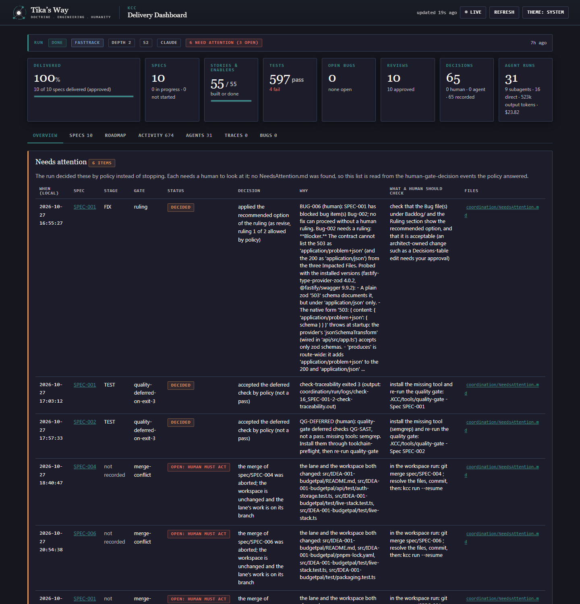
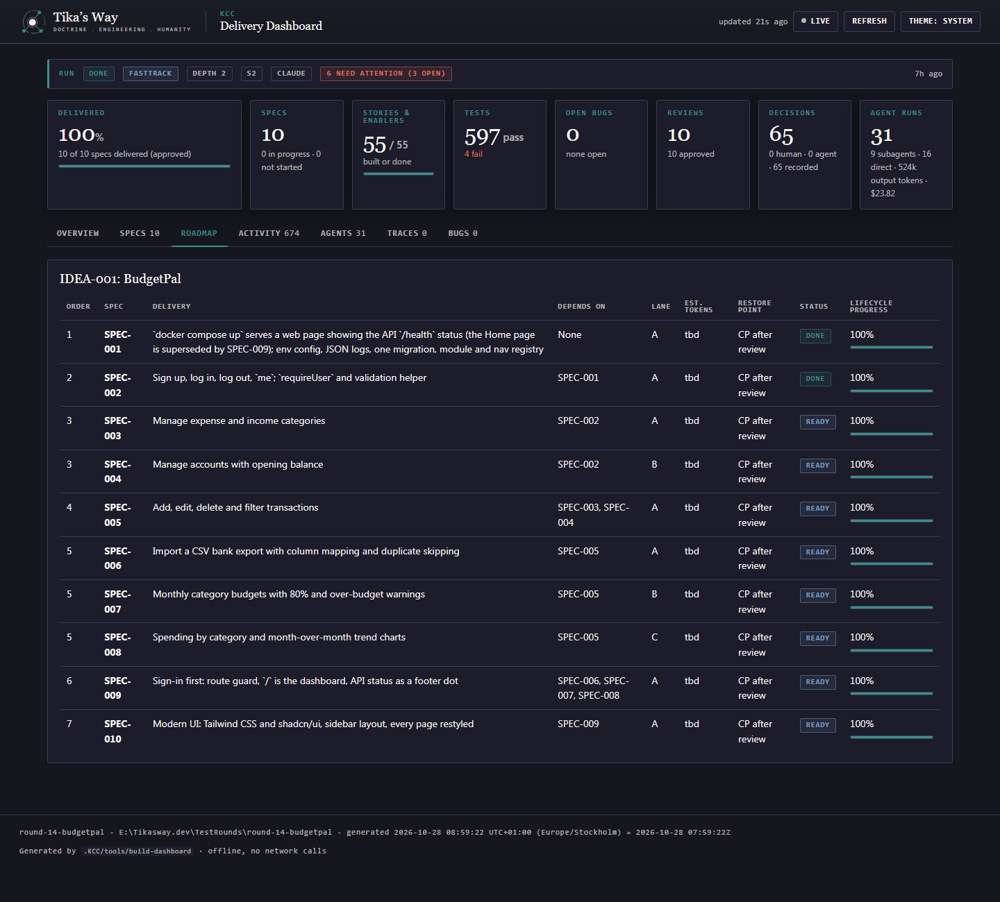
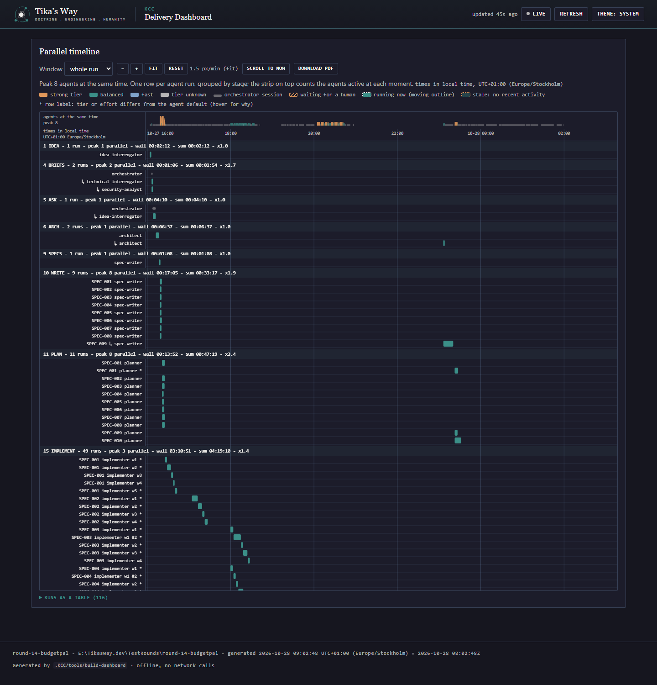
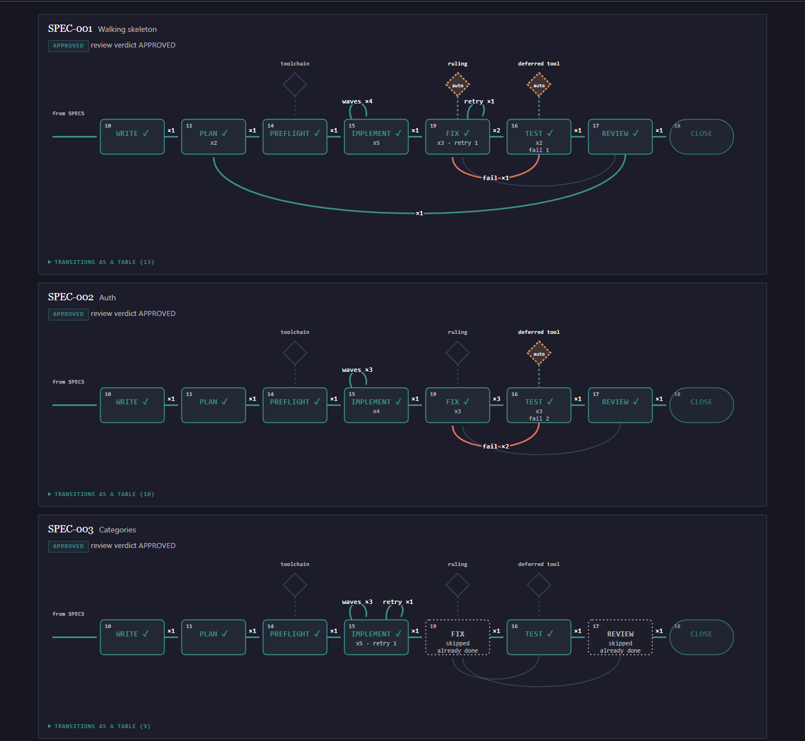
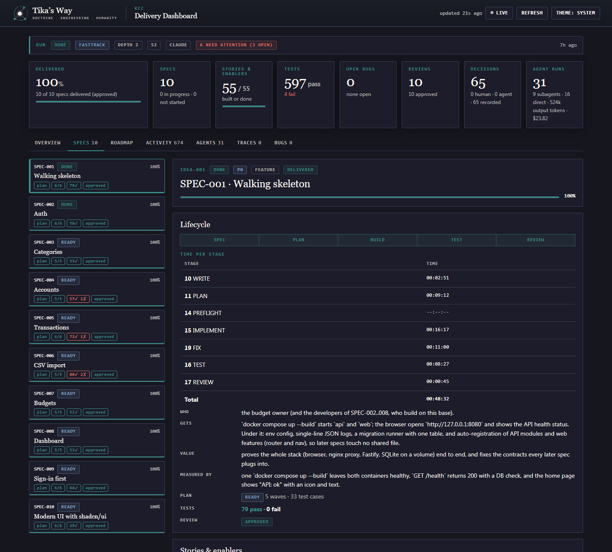
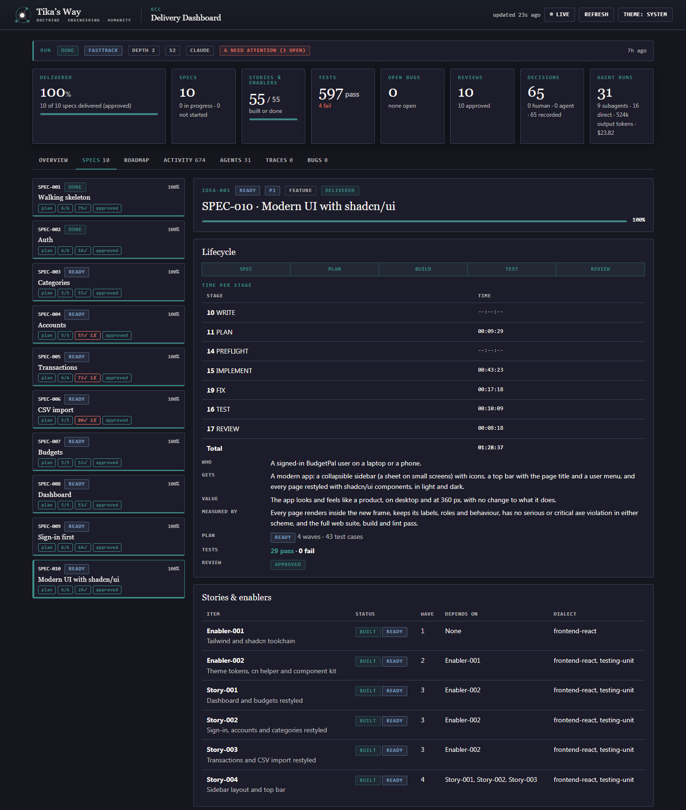
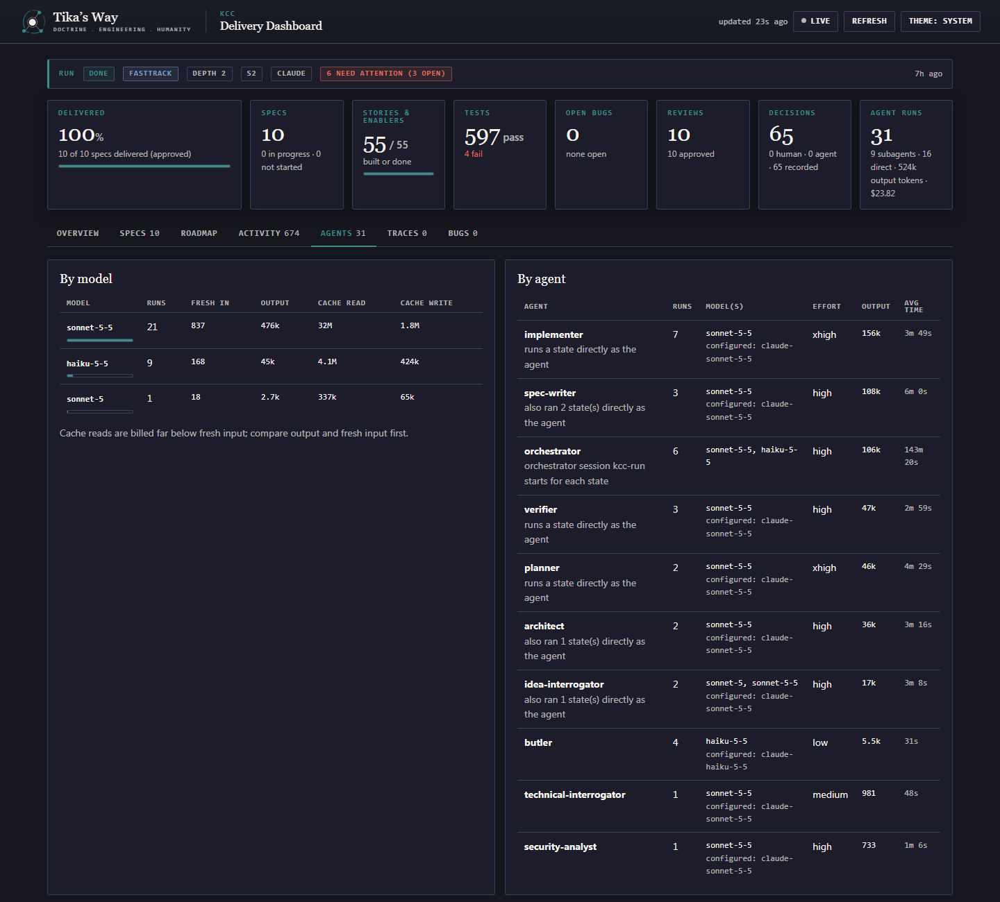
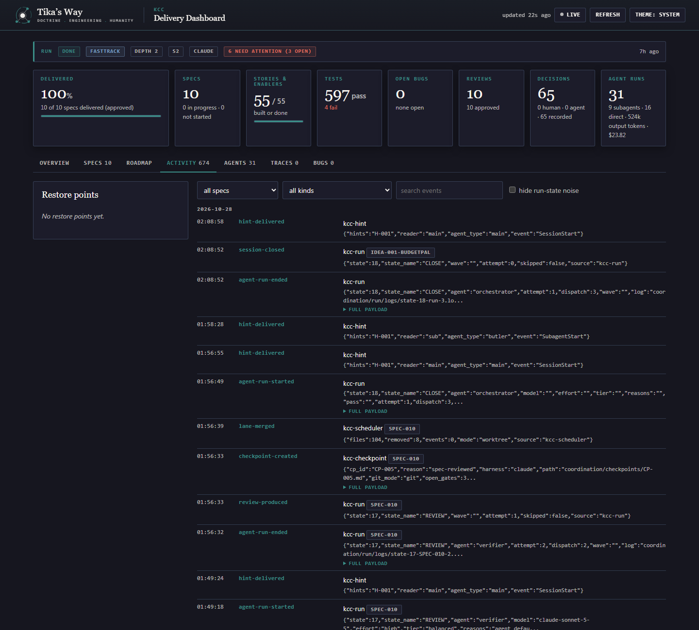

<p align="center">
  <a href="https://tikasway.dev">
    <picture>
      <source media="(prefers-color-scheme: dark)" srcset="docs/logo/tikasway-logo-dark.svg">
      <source media="(prefers-color-scheme: light)" srcset="docs/logo/tikasway-logo-light.svg">
      
    </picture>
  </a>
</p>

<p align="center">
  <a href="https://github.com/TarekFawaz/kcc-agentic-framework"></a>
  <a href="https://github.com/TarekFawaz/kcc-agentic-framework"></a>
  
  
  
  
  
  
  
  
  
  
  
  
  
  
  
</p>

# BudgetPal: a KCC Auto Fasttrack example

BudgetPal is a small personal budgeting web app. It is also a **worked example of the [KCC framework](https://github.com/TarekFawaz/kcc-agentic-framework)**: one paragraph of idea text went in, and the app, its specs, architecture, tests and reviews came out of a single unattended `kcc run --fasttrack --silent --assume` run, with as few human interventions as possible.

> **What this repo is for.** It is a simple, real project that shows what the KCC *auto fast-track* flow produces and what a human still has to do. Read it to see the artifacts, run the app, or copy the commands for your own idea. The app itself is deliberately ordinary: a local, single-user tool.

## Contents

1. [What BudgetPal does](#what-budgetpal-does)
2. [How it was built](#how-it-was-built)
3. [The human interventions](#the-human-interventions-honest-list)
4. [KCC commands used](#kcc-commands-used)
5. [Dashboard screenshots](#dashboard-screenshots)
6. [How to run it](#how-to-run-it)
7. [How to work with it](#how-to-work-with-it)
8. [Known limits](#known-limits)
9. [KCC repo and docs](#kcc-repo-and-docs)

## What BudgetPal does

- **Sign in first.** Only `/login` and `/signup` are public. Everything else needs a session (cookie, Argon2id password hashing, per-user data isolation on the server).
- **Accounts and categories** you manage yourself.
- **Transactions**: add, edit, delete, filter by month, account and category, 50 per page.
- **CSV import** of a bank export with column mapping, a preview, and duplicate detection.
- **Monthly budgets** per category with progress, an 80% "near limit" warning and an over-budget warning.
- **Dashboard** at `/`: spending by category and a month-over-month trend.
- **Modern UI**: Tailwind CSS and shadcn/ui, sidebar layout, light and dark theme that follows the operating system. The API status is a small dot in the footer.

Stack: pnpm monorepo with `api/` (Node 22+, Fastify 5, zod, SQLite via better-sqlite3) and `web/` (React 18, Vite 5, TanStack Query, Recharts, Tailwind 3.4, shadcn/ui). Packaged for `docker compose` (api plus nginx web).

## How it was built

The whole idea was one prompt (kept verbatim in [`ideation/IDEA-001-budgetpal/idea-001-budgetpal.md`](ideation/IDEA-001-budgetpal/idea-001-budgetpal.md)). In short:

> BudgetPal: a personal budgeting web app that helps a user see where their money goes and stay within monthly budgets. REST API (TypeScript on Node, SQLite) and a React + Vite frontend. Sign-up and login, accounts and categories, transactions with CSV import and duplicate detection, monthly budgets with progress, a dashboard with charts. Runs locally with docker-compose. Split the work into small specs with a thin walking skeleton first, so file-disjoint work can proceed in parallel.

The fast-track lifecycle then ran by itself:

```
idea -> technical + security briefs -> assumptions -> architecture -> spec split
     -> write specs -> plan -> implement (parallel lanes) -> test -> review -> close
```

| Spec | Delivers | Verdict |
|--|--|--|
| SPEC-001 walking skeleton | `/health`, one migration, one page, env config, JSON logs, compose files | APPROVED (Docker checks deferred by KCC, then verified by hand) |
| SPEC-002 auth | sign up, log in, log out, `me`, `requireUser` | APPROVED |
| SPEC-003 categories | expense and income categories | APPROVED |
| SPEC-004 accounts | accounts with opening balance | APPROVED |
| SPEC-005 transactions | add, edit, delete, filter | APPROVED |
| SPEC-006 csv-import | upload, map, preview, commit, dedupe | APPROVED |
| SPEC-007 budgets | monthly category budgets, 80% and over-budget warnings | APPROVED |
| SPEC-008 dashboard | spending by category, month-over-month trend | APPROVED |
| SPEC-009 signin-first | route guard, dashboard at `/`, API status as a footer dot | APPROVED |
| SPEC-010 shadcn-ui | Tailwind and shadcn/ui, sidebar layout, every page restyled | APPROVED |

SPEC-001 to SPEC-008 came from the first run. SPEC-009 and SPEC-010 were added later from a human bug report (see below). The build ran independent specs side by side in git worktree lanes (`.kcc-lanes/`) and merged each lane into `main`.

Numbers from the run (read from the [dashboard](#dashboard-screenshots) and the current checkout):

| | |
|--|--|
| Specs delivered | 10 of 10 APPROVED |
| Stories and enablers | 55 |
| Open bugs | 0 (7 were found and fixed with regression tests) |
| Agent runs | 31, about $23.82 in model cost as the dashboard tallies it |
| Tests now | api 406 passed, web 445 passed, workspace checks 40 passed; 4 skipped on purpose; lint clean |

The skipped tests are the Docker live-stack tests and one Windows-only signal test. KCC reports them as deferred, never as passed. The Docker stack itself was later tested by hand (see [the human interventions](#the-human-interventions-honest-list)).

## The human interventions (honest list)

The first run needed **no human input**: no questions were asked and no gate waited. The idea became specs and code under `--silent --assume`, with every assumption written to [`ideation/IDEA-001-budgetpal/Assumptions.md`](ideation/IDEA-001-budgetpal/Assumptions.md). Afterwards a person stepped in a handful of times:

| When | What the human did | Why it was needed |
|--|--|--|
| Environment | Chose to skip the Docker-registry steps and the SAST scan (`kcc hint`, recorded as hint H-001) | Docker could not reach the npm registry here, and semgrep was not installed. Skipped checks are reported as deferred, not passed |
| SPEC-001, SPEC-002 | Approved both reviews, with the skipped checks descoped | The traceability tool has no waiver state, so the human decision was written into the reviews |
| Review pass | Asked for the SR-018 rule false positive to be fixed | A Dockerfile pattern flagged a build stage name |
| After the first build | Ran `/bug-report` on the UX: API status as landing page, every page open before login, basic horizontal menu | A product decision, not a defect. It became two new specs (SPEC-009, SPEC-010) and a new stack decision (shadcn/ui) |
| After the final build | Walked through the finished app in a browser and tested the Docker stack by hand | KCC could not run the Docker or browser checks in its environment. This manual test is the human verification of the whole system: **verified** |
| Merges | Asked for merge conflicts in SPEC-001, SPEC-004 and SPEC-006 to be resolved | Parallel lanes touched the same README and lockfile. The scheduler parks such a spec and asks |

The run's own record of decided and open items is in [`coordination/run/closed.md`](coordination/run/closed.md) and the `coordination/NeedsAttention-*.md` files.

## KCC commands used

Setup, once per project (see the [KCC repo](#kcc-repo-and-docs)):

```sh
kcc init claude          # install .KCC/ and the Claude Code agents and skills
kcc doctor               # check the install
```

The main run. The flags below are the ones recorded in [`coordination/run/run.json`](coordination/run/run.json) (fast track, silent, assume, depth 2, scenario S2):

```sh
kcc run --input "<the BudgetPal idea text>" --fasttrack --silent --assume --depthlevel 2
```

| Command | What it did here |
|--|--|
| `--fasttrack` | The lean path: one idea pass, two briefs, one architecture file, small specs, parallel lanes, the full quality gate |
| `--silent --assume` | Never wait for a human. Gates are answered by policy and written to `NeedsAttention.md` |
| `--depthlevel 2` | Short artifacts (implied by `--fasttrack`) |
| `kcc hint "..."` or `/hint` | Told the running session and its subagents to skip Docker and SAST (H-001) |
| `/auto resume --fastrack` | Continue the run in Claude Code after the first stop |
| `kcc run --resume --fasttrack --silent --assume --depthlevel 2` | Terminal form of the same resume. It built SPEC-009 and SPEC-010 |
| `/bug-report <text>` | Turned the UX complaint into backlog items and new specs |
| `kcc dashboard` or `.KCC/tools/build-dashboard.ps1` | Rebuilt `dashboard/index.html` |

Other commands worth knowing: `kcc run --lane SPEC-NNN --from 16` (re-run a spec's test stage), `kcc report` (time and cost per stage), `kcc limits` (usage and the next resume), `.KCC/tools/kcc-handover` (switch harness or CLI mid-run).

## Dashboard screenshots

KCC writes a self-contained, offline dashboard to [`dashboard/index.html`](dashboard/index.html). Open it in a browser, or run `kcc dashboard --serve` for a live page. These screenshots were taken from it after the run closed.

**Overview.** Run status, delivered percentage, tests, bugs, reviews and agent runs, then the items the policy answered for a human to review.



**Roadmap.** The ten specs in build order, with dependencies, parallel lanes and progress.



**Parallel timeline.** Every agent run on a time axis, grouped by lifecycle stage. The strip on top counts agents working at the same moment (peak 8 during WRITE and PLAN, when every spec is written and planned side by side). The gaps are the pauses between the first run, the human decisions, and the SPEC-009 and SPEC-010 build. This is a crop of the first rows; the dashboard scrolls through all 116 runs.



**Spec flow.** One flowchart per spec showing the states it actually went through (WRITE, PLAN, PREFLIGHT, IMPLEMENT, FIX, TEST, REVIEW, CLOSE) and how often. Read it like this: SPEC-001 and SPEC-002 looped through FIX and TEST because a check failed or a tool was deferred, then reached REVIEW; SPEC-003 went straight through IMPLEMENT and TEST, with FIX and REVIEW skipped as already done. The dashed diamonds are gates the policy answered without a human (a ruling, a deferred tool). The first three specs are shown; the dashboard has all ten.



**Specs.** Each spec with its stories, enablers and review state.



**One spec.** SPEC-010 (shadcn/ui) with its backlog items and verdict.



**Agents.** Which KCC agent ran, how often, and what it cost.



**Activity.** The event log (`coordination/backchannel.jsonl`), one row per lifecycle event.



The overview still lists three merge conflicts as open because the dashboard reads the run's log, and those conflicts were resolved by hand afterwards (commits `9bf4a98` and `80ac757`). The "4 fail" under Tests is read from the recorded per-spec test summaries, which include failures from earlier passes that later bug fixes addressed. The current suite is green (numbers above).

## How to run it

The app lives in [`src/IDEA-001-budgetpal/`](src/IDEA-001-budgetpal/). Its own [README](src/IDEA-001-budgetpal/README.md) has the full environment table and the backup steps.

### Option 1: local dev servers

Needs Node 22 to 24 and pnpm 9 or newer.

```sh
cd src/IDEA-001-budgetpal
pnpm install --frozen-lockfile
pnpm -r build
```

Start the API in one terminal and the web app in another.

```sh
# API on http://127.0.0.1:3000  (bash / Git Bash)
PORT=3000 DATABASE_PATH=./data/dev.db COOKIE_SECURE=false pnpm --filter @budgetpal/api dev

# PowerShell equivalent
$env:PORT=3000; $env:DATABASE_PATH="./data/dev.db"; $env:COOKIE_SECURE="false"; pnpm --filter @budgetpal/api dev
```

```sh
# Web on http://127.0.0.1:5173 (Vite proxies /api to the API)
pnpm --filter @budgetpal/web dev
```

Then:

| What | URL |
|--|--|
| Web app | <http://127.0.0.1:5173> (you land on `/login`; use "Sign up" first) |
| API Swagger UI | <http://127.0.0.1:3000/docs/> |
| OpenAPI JSON | <http://127.0.0.1:3000/docs/json> |
| Health | <http://127.0.0.1:3000/health> |

Passwords must be 15 to 128 characters.

### Option 2: Docker Compose

```sh
cd src/IDEA-001-budgetpal
cp .env.example .env
docker compose up --build
```

Open <http://127.0.0.1:8080> (web) and <http://127.0.0.1:3000/docs/> (API). KCC could not run this path during the build because Docker could not reach the npm registry in its environment, so its automated checks for it are marked deferred. The stack was tested manually by the project owner and works.

### Tests

```sh
cd src/IDEA-001-budgetpal
pnpm lint
pnpm test          # api, web and workspace checks
```

## How to work with it

Where things are:

| Path | What is there |
|--|--|
| `src/IDEA-001-budgetpal/` | The app: `api/`, `web/`, `test/`, compose files |
| `ideation/IDEA-001-budgetpal/` | The idea, research, assumptions, technical and security briefs |
| `architecture/` | `architecture.md` (decisions D-1 to D-26, C4 diagrams), `quality-gates.md`, `static-rules.tsv` |
| `specs/IDEA-001-budgetpal-Specs/` | `ROADMAP.md` and one folder per spec: spec note, `Backlog/` items, `plan.md`, `review.md` |
| `TestResults/` | Per-spec traceability and quality-gate evidence |
| `coordination/` | Run state (`run/run.json`, `lanes.json`), `NeedsAttention*.md`, the event log, hints |
| `dashboard/index.html` | The generated dashboard |
| `.KCC/` | The framework source and tools, installed by `kcc init` |
| `CLAUDE.md`, `AGENTS.md` | Instructions the agents read every session |

Typical next steps with KCC:

- **Report a bug or a new need.** In Claude Code run `/bug-report <what you saw>`. KCC records it as a backlog item, plans a regression test, fixes it and re-reviews. A new requirement becomes a new story or spec.
- **Continue after an interruption or a usage limit.** `kcc run --resume`.
- **Steer a running session.** `kcc hint "text"`.
- **Add a feature.** Run `auto` or `kcc run --input "<the feature>"` against the existing idea, then check `specs/` and the dashboard.
- **Review the evidence.** Open a spec's `review.md`. APPROVED means traceability and the quality gate passed, with any deferred check named there.
- **Change the stack.** Decisions live in the `## Decisions` table of `architecture/architecture.md`. Edit there first, then re-plan.

Git workflow (from `CLAUDE.md`): `main` is protected, work happens on `spec/SPEC-NNN`, commit subjects look like `SPEC-NNN Story-NNN: ...`, and merges go through a pull request after an APPROVED review.

## Known limits

- **Docker checks are deferred in KCC's evidence.** The compose, container and browser smoke checks never ran inside the KCC run, so the reviews list them as deferred, not passed. The project owner tested the Docker stack manually and verified it.
- **No SAST.** semgrep was not installed, so the static-analysis scan is deferred. Lint, tests, dependency audit and the repo's own static rules did run.
- **nginx content-security policy is left as is, on purpose.** The production nginx config has no `style-src` rule. This was a deliberate choice for this example, so it is not a defect to fix.
- **Local single-user scope, by design.** No CSRF tokens, rate limiting, lockout or audit log, as the idea stated. Do not expose it to the internet.
- **Bundle size.** The web build is one 875 kB chunk. Code splitting was not part of the specs.
- **Manual verification is by the project owner.** The finished UI was walked through in a browser and the Docker stack was tested by hand. These checks are not in the KCC test evidence.

## KCC repo and docs

- KCC framework: <https://github.com/TarekFawaz/kcc-agentic-framework>
- Install `kcc`: `winget install Tikasway.KCC` (Windows), `brew install tarekfawaz/kcc/kcc` (macOS and Linux), or the script installers in the KCC README
- Quick start: `QUICKSTART.md` in the KCC repo
- CLI guide: `CLI-Guide.md` in the KCC repo
- This example: <https://github.com/TarekFawaz/KCC-Fasttrack-example-budgetpal>
- Built with KCC 0.6.0 on the Claude Code harness
