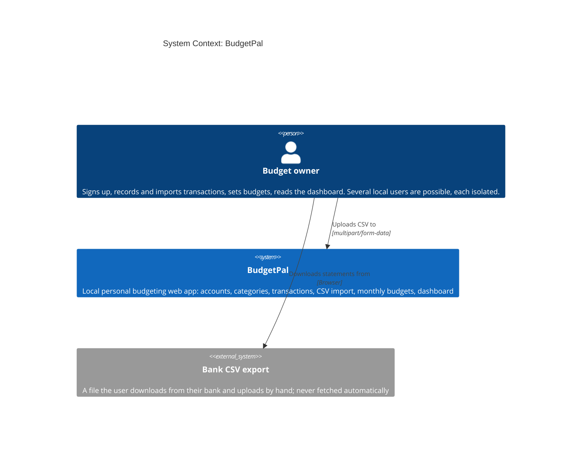
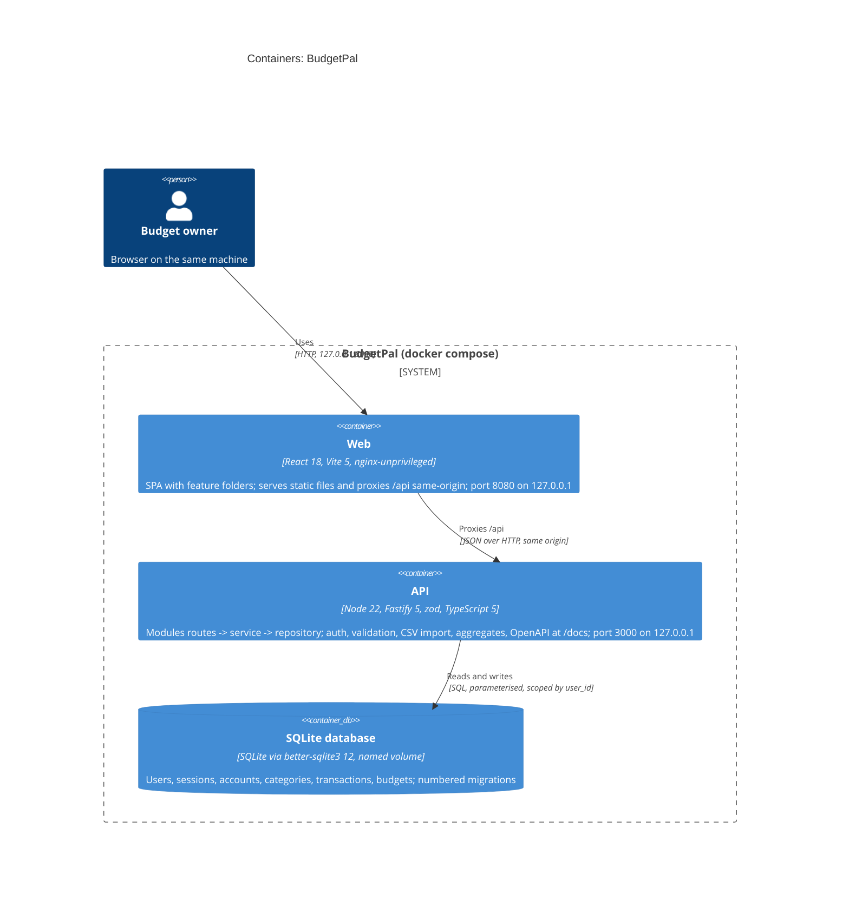
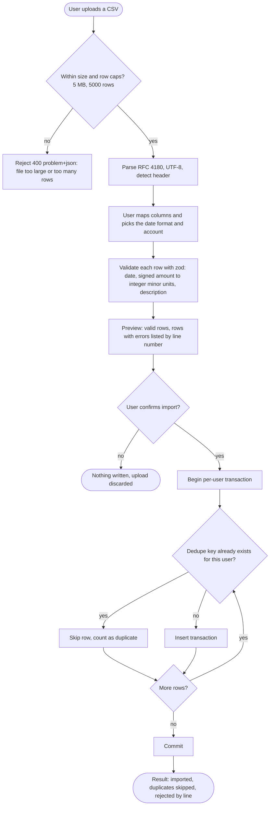

# Architecture Document - BudgetPal

## Overview

BudgetPal is a local-only personal budgeting web app. A person signs up on their own machine, manages accounts and categories, adds, edits, deletes or CSV-imports transactions (duplicates detected), sets a monthly budget per category with 80% and over-budget warnings, and reads a dashboard of spending by category and a month-over-month trend. It runs with `docker compose up` (services `api` and `web`) and talks to no external service.

This document is the stack source of truth for the planner, spec-writer (`## Architecture references`) and verifier (`QG-ARCH-CONFORMANCE`). The run uses the **fast-track profile**: decisions live in `## Decisions` below instead of ADR files, there is no spec-local `arch.md`, and the diagrams here are the only copies. Stack choices come from [[TechnicalDecisionBrief]], security scope from [[SecurityDecisionBrief]], the defaults taken silently from [[Assumptions]]. Source idea: [[idea-001-budgetpal]].

**Style.** Clean Architecture + DDD scaled down to a modular monolith (`architecture-styles.md` -> Default style selection rule: backend/fullstack). One deployable API, one static web container. Each module owns its folders and migration range, so specs for different modules touch disjoint files and run in parallel:

- API: `api/src/modules/<x>/` with `routes -> service -> repository`; shared code only from `api/src/kernel/`.
- Web: `web/src/features/<x>/`; shared code only from `web/src/kernel/`.
- E1 (walking skeleton) defines the **module registry**: the API auto-registers every `api/src/modules/*/index.ts` router, and the web auto-registers every `web/src/features/*/feature.ts` (route plus nav entry). No spec edits a shared router or nav file.
- Migrations are forward-only numbered SQL files, one file per epic, ranges reserved so parallel waves never collide: E1 `0001-0009`, E2 `0010-0019`, E3 `0030-0039`, E4 `0040-0049`, E5 `0050-0059`, E6 `0060-0069`, E7 `0070-0079`, E8 `0080-0089`.

## Context

The only actor is the person running the app. Their browser is the sole client; there are no external systems, no email, no telemetry. The system boundary is the user's machine, and the ports are published on loopback only (GR-001).

## Containers

Two containers and one volume, all started by `docker compose up`.

- **web** (`nginx-unprivileged`, port 8080): serves the built React + Vite SPA and proxies `/api` to the api container, so the browser sees one origin and cookies stay same-origin (no CORS, GR-005). Adds the security headers (`nosniff`, `Referrer-Policy: no-referrer`, CSP `self`).
- **api** (Node 22 on Debian-slim, port 3000): Fastify REST API. Validates every request with zod, enforces `requireUser` and `user_id` scoping, runs the migration runner at start, serves `GET /health`, the OpenAPI document and Swagger UI at `/docs`. Logs single-line JSON through pino.
- **SQLite file** (`better-sqlite3`, on the named volume `budgetpal-data`): one writer, WAL mode, foreign keys on. Holds users, sessions (hashed ids), accounts, categories, transactions, budgets. Back up by copying the file.

## Flows

Only the CSV import is a non-trivial workflow: it spans upload, mapping, preview and a transactional write with duplicate detection. The upload is never stored; the dedupe key is `sha256(user_id | account_id | date | amount_minor | normalised description)`, enforced by a unique index so a re-import adds nothing (GR-009).

## Decisions

Fast-track profile: decisions are rows here, not ADR files. "Std" cites `.KCC/kernel/protocols/standards-catalog.md`; "Styles" cites `architecture-styles.md`; "Human" is scope the human stated in the idea (a waiver, not an assumption). Status `Accepted (assumed)` means taken under `--silent --assume` from a catalogue default or the idea's own default.

| ID | Decision | Library or package (version range) | Citation | Status |
|--|--|--|--|--|
| D-01 | Architecture style: Clean Architecture + DDD as a modular monolith, `routes -> service -> repository`, module-owned folders and migration ranges | none (convention) | Styles: Default style selection rule; Modular monolith | Accepted |
| D-02 | Language and runtime | `typescript@^5`, `node >=22 <25` (containers use `node:22-bookworm-slim`; host Node 24 also supported) | Std: Tooling; Styles | Accepted (assumed) |
| D-03 | API framework with schema-first validation | `fastify@^5`, `fastify-type-provider-zod@^4`, `zod@^3` | Styles; Std: Validation at every boundary | Accepted (assumed) |
| D-04 | API contract: OpenAPI 3.1 generated from the zod schemas, Swagger UI at `/docs`, verifier-checked (QG-API-CONFORMANCE). No `Idempotency-Key` (local tool) | `@asteasolutions/zod-to-openapi@^7`, `@fastify/swagger@^9`, `@fastify/swagger-ui@^6` | `api-standards.md`: The default (all APIs) | Accepted |
| D-05 | Persistence: SQLite, WAL, foreign keys on, forward-only numbered migrations, one file per epic. `better-sqlite3` over `node:sqlite` (synchronous API with `transaction()`); the `^12` line is required because `^11` excludes the installed Node 24 | `better-sqlite3@^12` (engines `20 \|\| 22 \|\| 23 \|\| 24 \|\| 25 \|\| 26`) | Std: Data - migrations; Human: SQLite | Accepted |
| D-06 | Password hashing: Argon2id, OWASP floor m=19 MiB, t=2, p=1 (raise to t=3, m=64 MiB when the container allows); bcrypt only as a Docker-build fallback. Length min 15, max >= 64, no composition rules, bundled offline common-password list, generic invalid-credentials message | `argon2@^0.41` (fallback `bcrypt@^5`) | Std: Security - Password storage | Accepted (assumed) |
| D-07 | Sessions: random 256-bit id, only its SHA-256 hash stored in a SQLite `sessions` table; cookie `HttpOnly`, `SameSite=Lax`, `Path=/`, `Secure` from env `COOKIE_SECURE`; 24 h idle and 30 d absolute (env-tunable); new session at each login; logout deletes the row. Own small store, no session framework | `@fastify/cookie@^11`, `node:crypto` | Std: Security - Sessions | Accepted (assumed) |
| D-08 | Authorization and isolation: deny by default, `requireUser` on every data route, every repository function takes `userId` and every query is scoped by `user_id`, foreign keys verified to belong to the user, cross-user access returns 404, two-user test per module | none (convention in `api/src/kernel/`) | Std: Security - Authorization and data isolation | Accepted |
| D-09 | Open registration with several isolated local users; account enumeration accepted for a local tool | none | Std: Authorization and data isolation; Assumptions Q5 | Accepted (assumed) |
| D-10 | Input validation: zod `.strict()` bodies, params and query at every boundary; parameterised SQL only; React output encoding, no `dangerouslySetInnerHTML` | `zod@^3` | Std: Security - Input validation | Accepted |
| D-11 | Errors as RFC 9457 `application/problem+json` with field-level errors; generic bodies, no stack traces to the client | none (error handler in kernel) | Std: API - Errors (RFC 9457) | Accepted |
| D-12 | Pagination: offset/limit (default 50, max 200). Deviation from the catalogue's cursor default, accepted for local scale | none | Std: API - Pagination (deviation) | Accepted (assumed) |
| D-13 | Money: integer minor units, one ISO 4217 currency per install from env `CURRENCY` (default `USD`); dates `YYYY-MM-DD`, timestamps UTC ISO 8601; no floats for money | none (`Intl` for display) | Std: Data - Money (ISO 4217) | Accepted (assumed) |
| D-14 | CSV import: RFC 4180, UTF-8, header detection plus column-mapping step, date format chosen at mapping (ISO, `DD/MM/YYYY`, `MM/DD/YYYY`), caps 5 MB and 5000 rows, per-row validation reported by line, dedupe key hash with a unique index, upload not persisted, cells stored as plain text, no CSV export in v1 | `csv-parse@^5`, `@fastify/multipart@^9` | Std: Data - CSV import/export (RFC 4180) | Accepted (assumed) |
| D-15 | Budgets: one amount per category per month, no rollover, warn at >= 80%, over budget above 100%. Categories have a kind `expense` or `income`; the dashboard counts expenses only; no transfers in v1; aggregates computed in SQL | none | Idea defaults (Assumptions Q3, Q4); Styles | Accepted (assumed) |
| D-16 | Logging: single-line JSON to stdout with request id, allow-list field redaction; never log passwords, hashes, session ids, cookies, CSV content, or transaction descriptions and amounts | `pino@^9` | Std: Operations - Logging | Accepted |
| D-17 | Configuration from environment; `.env.example` lists names only (`PORT`, `DATABASE_PATH`, `SESSION_SECRET`, `CURRENCY`, `LOG_LEVEL`, `COOKIE_SECURE`); `.env` git-ignored; no default credentials or seeded users | `node:process` env read once in kernel config, validated by zod | Std: Operations - Configuration | Accepted |
| D-18 | Health: `GET /health` returns 200 `{status}` including a DB check; compose `healthcheck` on both services | none | Std: Operations - Health | Accepted |
| D-19 | Frontend: React SPA with feature folders, server state in TanStack Query, charts with Recharts (declarative; Chart.js rejected as imperative canvas), plain CSS modules with CSS-variable tokens, no UI kit (`@radix-ui` primitives only if a dialog or select is needed) | `react@^18`, `react-dom@^18`, `vite@^5`, `react-router@^6`, `@tanstack/react-query@^5`, `recharts@^2` | Styles; Std: Accessibility - WCAG 2.2 AA | Accepted (assumed) |
| D-20 | Accessibility and UX: WCAG 2.2 AA, keyboard reachable, visible focus, contrast >= 4.5:1, labelled inputs, light and dark by `prefers-color-scheme`, status never colour-only (green, amber at >= 80%, red over budget, each with icon and text), charts get a data-table alternative, single column below 768 px, usable to 360 px | `axe-core@^4` (tests) | Std: Accessibility - WCAG 2.2 AA | Accepted |
| D-21 | Packaging: two multi-stage Docker images (api on Debian-slim, build toolchain in the build stage only; web on `nginx-unprivileged`), non-root user, pinned base tags, SQLite on named volume `budgetpal-data`; Alpine rejected because of native-module build risk | Docker Compose v2 | Std: Operations - Containers | Accepted (assumed) |
| D-22 | Network exposure: publish `api` and `web` ports on `127.0.0.1` only (GR-001). The human said "local single-user tool", but a binding policy is a CR-7 question with no catalogue default, so it stays open in [[Assumptions]] (Security Q2) and the loopback binding is applied as the human-stated scope, not as a settled policy | none | Human: local single-user tool; Std: Security posture (no default; CR-7) | Proposed |
| D-23 | Tests: vitest, Fastify `inject` for API, Testing Library for web, mandatory two-user isolation test per module; coverage floor from `.KCC/settings.json` | `vitest@^2`, `@testing-library/react@^16`, `supertest@^7` (optional) | Std: Testing | Accepted (assumed) |
| D-24 | Repository tooling: pnpm workspace (`api/`, `web/`), committed lockfile, `pnpm audit` (no high-severity production advisories) in the quality gate, SemVer in root `package.json`, Conventional Commits | `pnpm >=9` | Std: Supply chain - lockfile and dependency audit | Accepted (assumed) |

### Waivers of catalogue defaults

Each row cites the human statement in [[idea-001-budgetpal]] (original request), not a tie-break. All of them are void if GR-001 is broken: exposing the app to a network reopens them and region selection (security brief G1).

| Catalogue default | Here | Human statement |
|--|--|--|
| CSRF token on state-changing requests | `SameSite=Lax` only; no state change on GET; mutating routes accept only `application/json` or multipart on upload; no permissive CORS | "no CSRF tokens" |
| Throttle and lockout on login and sign-up | none; Argon2id cost and the 15-char minimum slow guessing | "no rate limiting, no lockout" |
| Session rotation after login / privilege change | a new session id per login, nothing after (there are no privilege changes) | "no session rotation" |
| Audit log of auth events and access failures | application logs only, no audit table | "no audit log" |
| Proxy-aware client IP | not used | "no ... proxy-aware IP handling" |
| ASVS level 2 for financial data | ASVS L1 subset (V2, V3, V4, V5, V7) minus the controls above | "local single-user tool" |
| `Secure` cookie, HSTS | env flag, off on plain-http localhost | no TLS locally |
| SBOM, image scan, production-readiness checklist | not required (QG-PROD trimmed, see [[quality-gates]]) | "no SBOM or image-scan requirements, no production-readiness checklist" |

## Toolchain

Versions follow the machine: the host runs Node 24, the containers run Node 22. Every pin below supports both (`better-sqlite3@^12` lists 22 and 24; `vite@^5` and `vitest@^2` accept both).

| Tool | Version |
|--|--|
| node | >=22 <25 |
| pnpm | >=9 |
| typescript | ^5 |
| fastify | ^5 |
| fastify-type-provider-zod | ^4 |
| zod | ^3 |
| @asteasolutions/zod-to-openapi | ^7 |
| @fastify/swagger | ^9 |
| @fastify/swagger-ui | ^6 |
| @fastify/cookie | ^11 |
| @fastify/multipart | ^9 |
| better-sqlite3 | ^12 |
| argon2 | ^0.41 |
| pino | ^9 |
| csv-parse | ^5 |
| react | ^18 |
| react-dom | ^18 |
| vite | ^5 |
| react-router | ^6 |
| @tanstack/react-query | ^5 |
| recharts | ^2 |
| vitest | ^2 |
| @testing-library/react | ^16 |
| axe-core | ^4 |
| docker compose | >=2 |
| base image (api) | node:22-bookworm-slim |
| base image (web) | nginxinc/nginx-unprivileged (pinned tag) |

## Quality attributes

Prioritised: usability, maintainability, portability. Targets for a single local user, checked by the gates in [[quality-gates]]:

- **Usability and accessibility:** WCAG 2.2 AA, axe check on every page, empty states and inline validation errors on each page.
- **Maintainability:** module boundaries enforced by static rules (GR-006), one migration file per epic, a coverage floor from settings.
- **Portability:** one `docker compose up` on Windows, macOS or Linux; no host dependencies besides Docker.
- **Security:** the controls in D-06 to D-11 with the waivers above; two-user isolation proven per module.
- **Performance (budget):** list and aggregate endpoints under 200 ms p95 on 10,000 transactions; CSV import of 5000 rows under 10 s; API image under 400 MB.
- **Operability:** `/health`, JSON logs, env config, back up by copying the SQLite file.

## Risks and assumptions

- Native modules (`argon2`, `better-sqlite3`) fail to build in Docker - Debian-slim base, multi-stage build with the toolchain in the build stage only; `node:sqlite` is the documented fallback and needs a new Decisions row.
- Parallel specs collide on shared files - module and nav auto-registration (E1) and reserved migration ranges.
- A compose edit exposes the app beyond loopback - GR-001 and the compose check in QG-STATIC; D-22 stays `Proposed` until a human confirms the binding policy.
- Malicious or oversized CSV - caps, per-row validation, plain-text cells, no export (formula-injection risk deferred).
- Password minimum: the technical brief draft said 8, the security brief and [[Assumptions]] settled on 15 (catalogue); 15 is the decision (D-06).
- SQLite single writer on a Docker volume - fine at this scale.
- Silent-mode assumptions are the `Accepted (assumed)` rows above; their sources and risk are in [[Assumptions]].

## Open questions

1. **Network exposure** (Security Q2, CR-7, no catalogue default): confirm the api and web ports are published on `127.0.0.1` only. Until confirmed, GR-001 is applied as the human's "local single-user tool" scope and D-22 stays `Proposed`. Owner: ASK state / human.

## Reference artifacts

- Quality gates and guardrails: [[quality-gates]]
- Machine-checkable guardrail rules: `architecture/static-rules.tsv` (read by `quality-gate` QG-STATIC)
- Briefs: [[TechnicalDecisionBrief]], [[SecurityDecisionBrief]]
- Assumptions log: [[Assumptions]]
- Idea: [[idea-001-budgetpal]]
